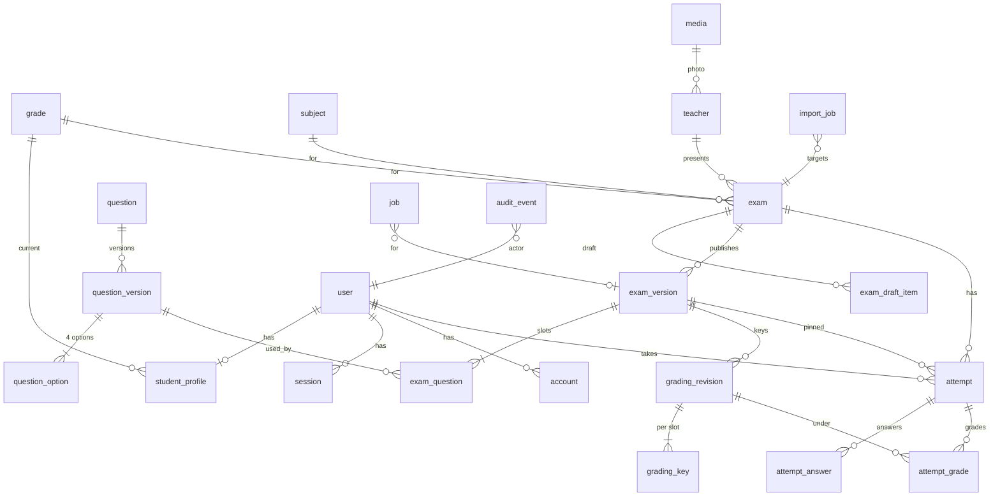

# e-Paperé Exams — Design

## 1. Architecture

One Next.js 16 (App Router, Node runtime) deployment, one PostgreSQL database, modular monolith.

```
src/
  app/                    routes (pages + thin route handlers under app/api/v1)
  components/             UI (ui/ = design system; exam/, admin/ = feature UI)
  lib/                    client-safe helpers (i18n, time formatting, math render)
  server/                 server-only modules ("server-only" import guard)
    db.ts                 Prisma client (pg adapter, bounded pool)
    env.ts                validated environment
    http/                 route wrapper: auth, origin check, problem details, request id
    auth/                 Better Auth config, actor resolution, throttle, passwords
    users/                student accounts, bulk registration, resets
    catalog/              grades, subjects, teachers
    authoring/            questions, question validation (shared), exams, publish
    imports/              CSV parser boundary + import jobs
    media/                upload validation, storage adapter (local fs / Vercel Blob)
    assessment/           eligibility, attempts, saves, submit, expiry, grading (pure)
    results/              ranking, release policy, review, exports, void, regrade
    platform/             audit, jobs, rate limit, logging
```

Rules: route handlers parse → call one service → map result. Pure functions (`grading.ts`, `ranking-rules.ts`, `release-policy.ts`, `deadline.ts`, `csv-validate.ts`) take plain values and are unit tested. Student DTOs are built in `assessment/dto.ts` from explicit `select`s — never spreading ORM rows.

## 2. Data model



Key tables (full definition in `prisma/schema.prisma` + `prisma/migrations/*/migration.sql`):

- `user` (Better Auth, + `role`, `disabled`, `must_change_password`, `username` = lower-case EP ID), `session`, `account`, `verification`.
- `student_profile(user_id PK, ep_id UNIQUE, full_name, display_name, grade_id, whatsapp_e164, school, district, pseudonymised_at)`.
- `question` / `question_version(version_no, stem, stem_media_id, stem_alt, explanation, marks CHECK>0, topic, difficulty, locked)` / `question_option(position CHECK 0..3, text, media_id, alt, is_correct)` with partial unique "one correct per version".
- `exam(slug UNIQUE, mode, status, duration_seconds NULL, opens_at, closes_at, allow_late_start, max_attempts, *_visibility, review_release_at, leaderboard_visibility, ranking_revision, current_version_id)`; CHECK: RANKED ⇒ closes_at and duration not null; opens < closes.
- `exam_draft_item(exam_id, position, question_version_id)` — editable list for drafts.
- `exam_version(exam_id, version_no, total_marks, question_count, latest_grading_revision_id)`; `exam_question(id, exam_version_id, position, question_version_id, marks)` with `UNIQUE(id, exam_version_id, question_version_id)` for composite FKs.
- `grading_revision(exam_version_id, revision_no, reason, created_by)`; `grading_key(grading_revision_id, exam_question_id, correct_option_id, marks)`.
- `attempt(exam_id, exam_version_id, user_id, kind OFFICIAL|PRACTICE, status IN_PROGRESS|SUBMITTED|GRADED, started_at, deadline_at NULL, submitted_at, finalize_reason MANUAL|EXPIRED, elapsed_ms, revision, controller_token, last_mutation_id, last_saved_at, score, max_score, percent_bp, grading_revision_id, voided_at, void_reason, replacement_granted, replaces_attempt_id UNIQUE)`.
  - `UNIQUE (exam_id, user_id) WHERE kind='OFFICIAL' AND voided_at IS NULL`
  - `UNIQUE (exam_id, user_id) WHERE status='IN_PROGRESS'`
  - CHECKs: graded ⇒ score/max/elapsed not null; score between 0 and max; OFFICIAL ⇒ deadline not null.
  - Indexes: ranking partial `(exam_id, score DESC, elapsed_ms ASC, id) WHERE kind='OFFICIAL' AND status='GRADED' AND voided_at IS NULL`; expiry `(deadline_at) WHERE status='IN_PROGRESS' AND deadline_at IS NOT NULL`; ownership `(user_id, exam_id)`.
- `attempt_answer(attempt_id, exam_question_id, exam_version_id, question_version_id, option_id NULL, revision, updated_at)` PK(attempt_id, exam_question_id). Composite FKs: `(attempt_id, exam_version_id) → attempt(id, exam_version_id)`, `(exam_question_id, exam_version_id, question_version_id) → exam_question`, `(option_id, question_version_id) → question_option(id, question_version_id)`.
- `attempt_grade(attempt_id, grading_revision_id, score, max_score, graded_at)` UNIQUE(attempt_id, grading_revision_id) — grade history.
- `import_job`, `media`, `job`, `audit_event`, `rate_limit_bucket`, `app_setting(key, value jsonb)` (non-secret branding).

Deletes: `ON DELETE RESTRICT` on all assessment history; only auth `session/account` cascade from `user` (users are never hard-deleted by UI).

## 3. Timing, saving and concurrency protocol (ADR-003, ADR-004)

Server clock = PostgreSQL `clock_timestamp()` evaluated after the attempt row lock is held. All writes to an attempt serialise on its row.

**Start** (`POST /api/v1/exams/{slug}/attempts`): eligibility → `INSERT … ON CONFLICT DO NOTHING` against the partial unique indexes → return existing in-progress or official attempt. `deadline_at = LEAST(now + duration, closes_at)`. Returns `{attempt, serverTime, deadlineAt, controllerToken}`.

**Save** (`PUT /api/v1/attempts/{id}/answers`): one statement-level CAS:
```sql
UPDATE attempt SET revision = revision+1, last_mutation_id=$m, last_saved_at=clock_timestamp()
WHERE id=$a AND user_id=$u AND status='IN_PROGRESS' AND voided_at IS NULL
  AND revision=$base AND controller_token=$tok
  AND (deadline_at IS NULL OR clock_timestamp() < deadline_at)
RETURNING revision;
```
Then upsert answers (validated membership) in the same transaction. If 0 rows: re-read and classify → duplicate (`last_mutation_id=$m` → 200 with stored revision), `ATTEMPT_FINALIZED`, deadline passed (lazy finalise, 409 ATTEMPT_FINALIZED), `CONTROLLER_CHANGED`, else `REVISION_CONFLICT` with canonical answers. Client keeps one batch in flight, so an older mutation can never succeed after a newer one.

**Takeover** (`POST /attempts/{id}/controller`): rotates `controller_token`; previous tab gets CONTROLLER_CHANGED and becomes read-only with a "Continue here" control.

**Submit** (`POST /attempts/{id}/submit`, body `{baseRevision, controllerToken, finalChanges[]}`): single transaction, `SELECT … FOR UPDATE`; finalised → canonical receipt (idempotent, same `submitted_at`/`elapsed_ms`). `t = clock_timestamp()`. If `deadline_at <= t` → finalise EXPIRED ignoring `finalChanges`. Else require token+revision match (409 otherwise; client refetches, keeps selections, retries), apply `finalChanges`, grade, persist. `elapsed_ms = min(t, deadline) − started_at` (MANUAL) or `deadline − started_at` (EXPIRED).

**Expiry**: `finalizeExpired(batch)` selects `status='IN_PROGRESS' AND deadline_at <= clock_timestamp() FOR UPDATE SKIP LOCKED LIMIT n` and finalises each with saved answers. Called by the job runner and lazily by attempt reads/saves.

Race outcomes are deterministic: whichever transaction holds the row lock first decides; later ones re-check status/deadline under the lock. Settlement window: none — the cutoff is the deadline instant.

## 4. Grading (ADR-005)

`gradeAttempt(keys: {examQuestionId, correctOptionId, marks}[], answers: Map<examQuestionId, optionId|null>) → {score, maxScore, percentBp, perQuestion[]}` — pure, total over keys, integer arithmetic. Unknown answer slots throw (cannot happen given FKs). Submit writes `attempt` fields + `attempt_grade` row atomically.

Regrade: correction creates `grading_revision n+1` (copy of n with changed rows) and sets `exam_version.latest_grading_revision_id`; new submissions grade against latest immediately. A `REGRADE_EXAM_VERSION` job regrades `GRADED` attempts whose `grading_revision_id <> latest` in batches of 200 (idempotent: `attempt_grade` unique). Leaderboard ranks only rows on latest revision and reports `PROVISIONAL (regrading N)` until zero remain.

## 5. Ranking (ADR-006)

```sql
WITH ranked AS (
  SELECT a.id, a.user_id, a.score, a.max_score, a.elapsed_ms,
         RANK() OVER (ORDER BY a.score DESC, a.elapsed_ms ASC) AS rank
  FROM attempt a JOIN exam_version v ON v.id = a.exam_version_id
  WHERE a.exam_id = $1 AND a.kind='OFFICIAL' AND a.status='GRADED' AND a.voided_at IS NULL
    AND a.grading_revision_id = v.latest_grading_revision_id)
SELECT … FROM ranked ORDER BY rank, elapsed_ms, id LIMIT $2 OFFSET $3;
```
Own rank: `1 + count(*) WHERE score > s OR (score = s AND elapsed_ms < e)` over the same filter. Status computed per §R7.4. No caching until measured.

## 6. Release policy

`releaseState(exam, now)` returns booleans `{score, correctness, correctAnswer, explanation}`; IMMEDIATE → true once graded; AFTER_RELEASE → `now >= review_release_at ?? closes_at`; NEVER → false. Review DTO includes only permitted fields.

## 7. Jobs (ADR-007)

`job(type, payload, status QUEUED|RUNNING|SUCCEEDED|FAILED, attempts, max_attempts, run_after, lease_until, dedupe_key UNIQUE, last_error)`. Claim with `FOR UPDATE SKIP LOCKED`, lease 120 s, backoff `2^n·10s`, terminal FAILED surfaced in admin overview. Types: `GRADE_ATTEMPT`, `REGRADE_EXAM_VERSION`. Runner: `POST /api/internal/jobs/run` (Bearer `CRON_SECRET`), each invocation: finalise ≤ 500 expired attempts, run ≤ 10 jobs, time budget 20 s.

## 8. Security

- Better Auth server API only (no public catch-all handler); our routes `POST /api/v1/auth/login|logout|password`.
- `withRoute()` wrapper: request id, size limit, origin check for non-GET, session → `Actor`, role guard, Zod parse, problem-details mapping, `Cache-Control: no-store`.
- CSP: `default-src 'self'; img-src 'self' data: blob:; style-src 'self' 'unsafe-inline'; script-src 'self' 'unsafe-inline'` (Next inline bootstrap; nonce CSP is POST hardening), `frame-ancestors 'none'`.
- Answer keys only read in `assessment/submit.ts`, `results/*` (admin or released), `authoring/*` (admin).

## 9. Client attempt engine

`useAttemptSync` (React hook, plain module `lib/attempt/sync-queue.ts` unit-tested): pending map, debounce 800 ms, max wait 4 s, single in-flight, backoff `min(30s, 1s·2^n) ± 30% jitter`, Retry-After honoured, IndexedDB-free localStorage key `ep:pending:{userId}:{attemptId}` (small payload), cleared on finalise/logout (`ep:pending:*` sweep) and when the user ID differs. Countdown uses `performance.now()` offset from server time; re-syncs on `visibilitychange`/online.

## 10. Deployment

Vercel (region `sin1` or nearest to Neon region), Neon pooled URL for runtime (`DATABASE_URL`, PgBouncer transaction mode, pg pool max 5 per function instance) and direct URL for migrations (`DIRECT_DATABASE_URL`). Vercel Blob private store for media (`BLOB_READ_WRITE_TOKEN`); local filesystem store in dev/test. Details in `docs/deployment.md`.
