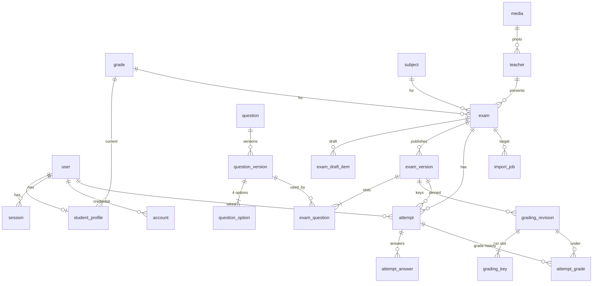

# Architecture

Modular monolith: one Next.js deployment, one PostgreSQL database. Full rationale is in [.kiro/specs/epapere-exams/design.md](../.kiro/specs/epapere-exams/design.md) and [ADRs](adr.md). This page is the operational summary.

## Module map

| Module (`src/server/…`) | Owns | Public entry points |
|---|---|---|
| `auth` | sessions (Better Auth), throttling, password ops, actor resolution | `resolveActor`, `login`, `changePassword`, `postLoginPath` |
| `users` | student profiles, accounts, bulk registration | `createStudent`, `runStudentCommand`, `bulkRegister`, `getStudentDetail` |
| `catalog` | grades, subjects, teachers, branding, dashboards | `listCatalog`, `saveCatalogRecord`, `studentDashboard`, `examLanding` |
| `authoring` | question bank + versions, exams, publication | `createQuestion`, `updateQuestion`, `createExam`, `runExamCommand`, `getExamForEditor` |
| `imports` | CSV parser boundary, staging, idempotent commit | `parseQuestionCsv`, `stageImportForActor`, `editAndRevalidate`, `commitImport` |
| `media` | upload validation, storage adapter, authorised delivery | `uploadMedia`, `getMediaForDelivery` |
| `assessment` | eligibility, attempts, saves, submit, expiry, grading (pure) | `startAttempt`, `saveAnswers`, `submitAttempt`, `finalizeExpired`, `gradeAttempt` |
| `results` | release policy, review, per-exam ranking, exports, void, regrade | `getResultForStudent`, `getLeaderboard`, `exportResults`, `voidAttempt`, `createGradingCorrection` |
| `platform` | audit, jobs, rate limits, logging, CSV safety | `audit`, `enqueue`, `runJobsOnce`, `hit` |
| `http` | `withRoute()`, problem details, contracts, OpenAPI | `withRoute`, `idParams`, `fileResponse` |

Rules enforced by lint: client code cannot import `@/server/*`; pages and routes cannot import the database client. Request schemas live in DB-free files (`*/schemas.ts`, `http/contracts.ts`) and also generate the OpenAPI document.

## Data model

Database-enforced invariants (`prisma/migrations/20261120000100_constraints`):

- One non-void OFFICIAL attempt per (exam, student), and one IN_PROGRESS attempt per (exam, student). Both are partial unique indexes, tested under 20 concurrent starts.
- Answer membership is enforced by composite foreign keys: answer → attempt's exam version → slot → question version → option. A foreign question or option cannot be stored.
- Grading keys must belong to the same exam version, and each correct option must belong to its question version.
- CHECKs:
  - GRADED ⇔ score, max, percent, revision and graded_at are all present.
  - 0 ≤ score ≤ max.
  - OFFICIAL ⇒ the deadline is set.
  - A published RANKED exam has a close time and a duration.
  - Void ⇔ a reason is recorded.
  - Marks are between 1 and 100.
  - Exactly one correct option per question version.
- History uses `ON DELETE RESTRICT`. Only auth sessions and accounts cascade from a user, and users are never hard-deleted from the UI.

## Timing, saving and concurrency (ADR-003, ADR-004)

| Rule | Implementation | Evidence |
|---|---|---|
| Server clock only | `clock_timestamp()` read **after** `SELECT … FOR UPDATE` on the attempt row | `assessment/finalize.ts::lockAttempt` |
| Deadline | `LEAST(started_at + duration, closes_at)` computed by the DB at insert; null only for untimed practice without close | unit + integration tests |
| Admission | a save or submit is admitted iff `now < deadline` (strict). There is no settlement window. | race test: nothing stored at or after the deadline |
| Save | One transaction: lock, then dedupe by `mutationId`, then gate (finalised → deadline → controller → revision), then validate membership, upsert, bump revision. The answer `updated_at` is the admitted receipt time. | CAS, duplicate, out-of-order and concurrent-save tests |
| Tabs/devices | One `controller_token` per attempt. Takeover rotates it; the old tab gets `CONTROLLER_CHANGED` and becomes read-only, keeping its selections. | takeover test, sync-queue unit test |
| Submit | Same lock. Already finalised → canonical receipt (same time). Past the deadline → EXPIRED with saved answers only. Otherwise apply `finalChanges`, then grade and commit in one transaction. | duplicate, concurrent-payload, response-loss and DB-fault tests |
| Expiry | `finalizeExpired` (`FOR UPDATE SKIP LOCKED`, batches of 50) from the job runner, plus lazy finalisation on any read or write. Elapsed = deadline − start. | browser-closed and race tests |
| Client | Debounce 800 ms, max wait 4 s, one in-flight batch, backoff 1→30 s ±30 % honouring Retry-After. "Saved" only after acknowledgement. Recovery data is keyed by user + attempt, and other users' data is removed on a shared device. | `tests/unit/sync-queue.test.ts`, E2E offline test |

An answer change that reaches the server at or after the deadline is not counted, even if the student clicked earlier. Students are told this before starting ("your saved answers are submitted automatically"). Ordinary network delay can affect the recorded time, so ranking does not claim millisecond fairness.

## Scoring and ranking (ADR-005, ADR-006)

- Score = Σ marks of slots whose accepted option equals the key, using stable option IDs (never letters or indices). Unanswered and incorrect answers score 0, with no negative marking. Percent is stored in basis points.
- A grading fault never produces a fake score. A DB error rolls back everything; acknowledged answers persist. A key-data fault commits the attempt as SUBMITTED with a NULL score and a `GRADE_ATTEMPT` job.
- Leaderboard: one exam only. Eligible attempts are OFFICIAL, GRADED, not void, and graded on the latest grading revision. Order is `score DESC, elapsed_ms ASC` with `RANK()` (1, 2, 2, 4). The ID only stabilises pagination.
- FINAL requires: close time passed, no official attempts in progress or awaiting grading, and no attempts on an older grading revision. Void or regrade increments `ranking_revision` and shows a notice.

### Query plans (measured, `tests/integration/query-plans.test.ts`)

Dataset: exam A has 5,000 graded attempts among 46,000 attempts across 10 exams. Local embedded PostgreSQL 18.7 on a developer laptop. This is not a production measurement.

| Query | Plan | Execution |
|---|---|---|
| Leaderboard page (window RANK, LIMIT 50) | Bitmap Index Scan `attempt_exam_id_status_idx` (exam_id, status) → sort 5,000 rows → WindowAgg → top-N | 10.7 ms |
| Own rank (count strictly better) | Bitmap Index Scans on partial `attempt_ranking` (exam_id, score DESC, elapsed_ms) | 0.73 ms |
| `getLeaderboard()` page 40 with own rank, wall time | — | 26 ms |

When one exam dominates the table (5,000 of 6,000 rows), PostgreSQL correctly chooses a sequential scan, at 9.9 ms. Every query filters by exam before ranking, and no query reads other exams' rows into ranking. Leaderboards are computed per request with no cache, because the cost was measured as small. Add a bounded cache only if the staging load test shows a need (ADR-006).

## Pool budget

Each server instance uses `DATABASE_POOL_MAX` (default 5) connections to Neon's **pooled** endpoint (PgBouncer, transaction mode). Interactive transactions are short: 5 s max wait, 10 s timeout, and a 10 s statement timeout. No network calls happen inside a transaction (media upload writes storage before the DB insert). Size Neon compute from the staging load test, not from the pooler's client limit.
